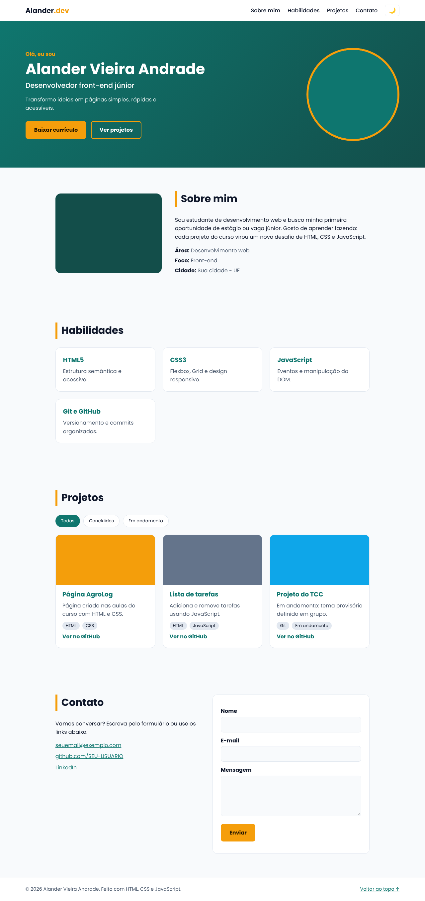

# Portfólio | Alander Vieira Andrade

## Objetivo
Apresentar meu perfil, minhas habilidades e meus projetos para recrutadoras e recrutadores, como parte da Atividade Prática do curso de desenvolvimento web.

## Tecnologias usadas
- HTML5 semântico
- CSS3 (Flexbox, Grid e media queries)
- JavaScript (menu, tema claro/escuro, filtro de projetos e formulário)
- Git e GitHub

## Como abrir
1. Baixe ou clone o repositório: `git clone https://github.com/alandervieiraandrade-ui/2311aula.git
2. Abra a pasta `portfolio`.
3. Dê dois cliques no arquivo `index.html` para abrir no navegador.

## Contato
- E-mail: alandervieiraandrade@gmail.com
- GitHub: https://github.com/alandervieiraandrade-ui